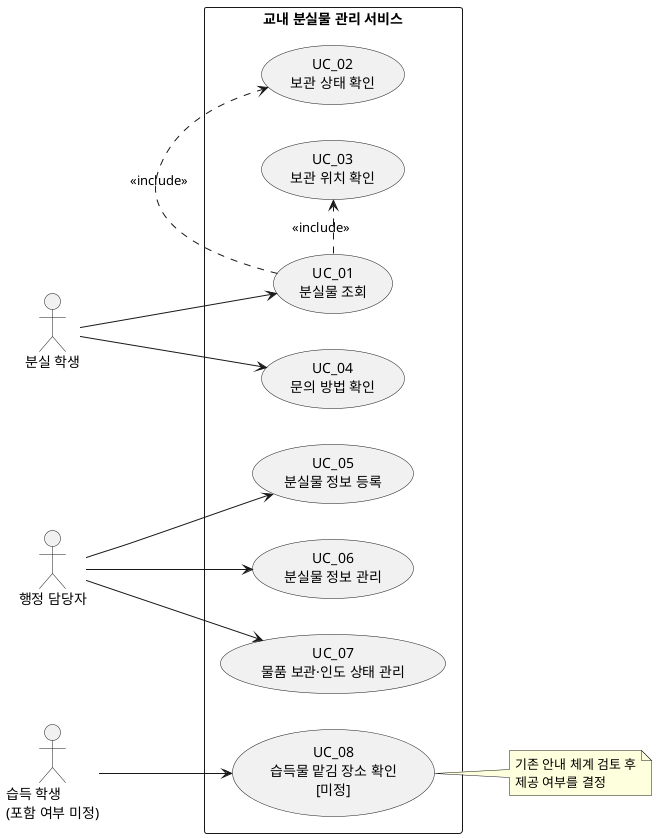

# Use Case 식별서 v0.1

## 1. 분석 기준

본 문서는 고객 요구사항과 SRS v0.1을 바탕으로, 사용자가 **무엇을 왜 하려는지**를 중심으로 Use Case를 식별한다. 현재 포함 범위는 분실물 조회, 물품 등록·상태 관리, 문의 방법 안내이다. 사진 기반 검색·자동 알림·실제 개인정보·학교 인증 연동은 범위에서 제외한다.

## 2. 액터 목록

| 액터 ID | 액터 | 유형 | 서비스와의 관계 및 목적 | 근거 |
|---|---|---|---|---|
| ACT_01 | 분실 학생 | 주 액터 | 행정실을 방문하기 전에 잃어버린 물품의 보관 여부·보관 위치를 확인하고, 필요 시 담당 부서에 문의하려 한다. | NEEDS_1, NEEDS_4 |
| ACT_02 | 행정 담당자 | 주 액터 | 습득·보관된 물품을 등록하고, 인도 여부를 관리하여 반복 문의를 줄이려 한다. | NEEDS_2, NEEDS_3, NEEDS_7 |
| ACT_03 | 습득 학생 | 후보 액터 | 주운 물품을 맡길 장소를 알고 싶어 한다. 해당 안내 기능의 시스템 포함 여부는 미정이다. | NEEDS_5, SC4 |
| ACT_04 | 정보보호 담당자 | 이해관계자 | 조회 화면의 공개 정보 범위와 개인정보 보호 정책을 검토한다. 현재 시스템 조작 Use Case는 확인되지 않았다. | S4, Pol_00, Pol_01 |
| ACT_05 | 서비스 운영 책임자 | 이해관계자 | 운영 정책, 담당 부서, 권한 및 미정 범위를 결정한다. 현재 시스템 조작 Use Case는 확인되지 않았다. | 이해관계자 목록, Pol_07 |

> ACT_04와 ACT_05는 현재 요구사항에서 시스템을 직접 사용하는 행위가 확인되지 않아 Use Case Diagram의 주 액터로는 포함하지 않았다.

## 3. Use Case 목록

| UC ID | Use Case | 액터 | 사용자 목표(무엇을 / 왜) | 포함 관계 | 범위 상태 | 근거 |
|---|---|---|---|---|---|---|
| UC_01 | 분실물 조회 | ACT_01 분실 학생 | 물품의 보관 여부와 보관 위치를 확인하여 불필요한 행정실 방문을 줄이려 한다. | UC_02, UC_03 포함 | 포함 | NEEDS_1, FR_00, FR_01 |
| UC_02 | 보관 상태 확인 | ACT_01 분실 학생 | 찾는 물품이 현재 보관 중인지 또는 이미 인도 완료인지 판단하려 한다. | UC_01에 포함 | 포함 | NEEDS_1, NEEDS_3, FR_00, FR_05 |
| UC_03 | 보관 위치 확인 | ACT_01 분실 학생 | 물품이 보관된 장소를 알아 방문 또는 수령 준비를 하려 한다. | UC_01에 포함 | 포함 | NEEDS_1, FR_01 |
| UC_04 | 문의 방법 확인 | ACT_01 분실 학생 | 추가 확인이 필요할 때 개인 연락처가 아닌 공식 담당 부서에 안전하게 문의하려 한다. | UC_01 이후 선택 가능 | 포함 | NEEDS_4, FR_06, Pol_01, Pol_02 |
| UC_05 | 분실물 정보 등록 | ACT_02 행정 담당자 | 보관 중인 물품의 정보를 등록해 학생이 직접 조회할 수 있도록 하고 반복 문의를 줄이려 한다. | 없음 | 포함 | NEEDS_2, NEEDS_7, FR_02 |
| UC_06 | 분실물 정보 관리 | ACT_02 행정 담당자 | 등록된 물품 정보를 최신 상태로 관리하려 한다. | 없음 | 포함 | NEEDS_2, FR_03 |
| UC_07 | 물품 보관·인도 상태 관리 | ACT_02 행정 담당자 | 물품의 보관 중/인도 완료 상태를 기록·구분하여 실제 보관 상황을 관리하려 한다. | UC_06과 연관 | 포함 | NEEDS_3, FR_04, FR_05 |
| UC_08 | 습득물 맡김 장소 확인 | ACT_03 습득 학생 | 주운 물품을 어디에 맡겨야 하는지 알아 올바르게 인계하려 한다. | 없음 | **미정** | NEEDS_5, SC4, Pol_06 |

## 4. Use Case Diagram (PlantUML)

## 5. 고객 확인 사항

| 질문 ID | 고객 확인 질문 | 영향 범위 |
|---|---|---|
| Q_01 | 분실물 조회 시 학생이 어떤 조건으로 검색해야 하나요? 예: 물품명, 습득일, 물품 종류, 보관 장소. | UC_01 |
| Q_02 | 조회 결과에서 `인도 완료` 물품도 학생에게 표시할까요? 표시한다면 보관 위치도 함께 공개할까요? | UC_01, UC_02, UC_03 |
| Q_03 | 보관 위치는 어느 수준까지 표시할까요? 예: 행정실, 담당 부서, 상세 보관함 위치. | UC_03, Pol_00 |
| Q_04 | 문의 방법으로 어떤 정보를 표시할까요? 예: 담당 부서명, 대표 전화, 이메일, 운영시간, 방문 안내. | UC_04 |
| Q_05 | 물품 등록 시 반드시 입력해야 하는 정보는 무엇인가요? | UC_05 |
| Q_06 | 등록된 물품 정보를 수정·삭제하거나 상태를 변경할 수 있는 역할은 누구인가요? | UC_06, UC_07 |
| Q_07 | 인도 완료 상태를 잘못 처리했을 때 누가 어떤 절차로 정정하나요? | UC_07 |
| Q_08 | 습득물 맡김 장소 안내를 이번 시스템에 포함할까요, 아니면 기존 오프라인 안내로 유지할까요? | UC_08 |
| Q_09 | 행정 담당자의 등록 업무 부담을 측정할 기준과 목표치는 무엇인가요? 예: 물품 1건 등록 평균 소요 시간. | UC_05 |
