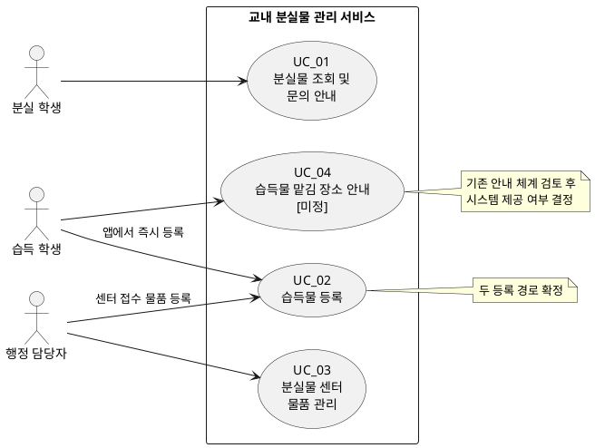

# Use Case 식별서 v0.2

## 1. 분석 기준

본 문서는 고객 요구사항, SRS v0.1 및 확정된 습득물 등록 방식을 바탕으로 작성했다. Use Case는 조회·등록·관리처럼 사용자가 달성하려는 **하나의 서비스 단위**로 식별하며, 화면의 세부 행동은 독립 Use Case로 분리하지 않는다.

습득물 등록은 다음 두 경로를 제공하는 것으로 확정한다.

- 습득 학생은 습득한 물품을 앱에서 바로 등록한다.
- 행정 담당자는 분실물 센터로 접수된 습득 물품을 등록한다.

사진 기반 검색·자동 알림·실제 개인정보·학교 인증 연동은 범위에서 제외한다. 습득물 맡김 장소 안내의 시스템 포함 여부는 아직 미정이다.

## 2. 액터 목록

| 액터 ID | 액터 | 유형 | 서비스와의 관계 및 목적 |
|---|---|---|---|
| ACT_01 | 분실 학생 | 주 액터 | 방문 전에 분실물의 보관 여부·위치를 확인하고, 필요하면 공식 문의 방법을 확인한다. |
| ACT_02 | 행정 담당자 | 주 액터 | 분실물 센터에 접수된 습득 물품을 등록하고, 물품 정보와 보관·인도 상태를 관리한다. |
| ACT_03 | 습득 학생 | 주 액터 | 습득한 물품을 앱에서 즉시 등록한다. |
| ACT_04 | 정보보호 담당자 | 이해관계자 | 조회 정보의 공개 범위와 개인정보 보호 정책을 검토한다. 시스템 직접 조작 요구는 확인되지 않았다. |
| ACT_05 | 서비스 운영 책임자 | 이해관계자 | 담당 부서, 권한, 상태 정정 절차 및 미정 범위를 결정한다. 시스템 직접 조작 요구는 확인되지 않았다. |

> ACT_04와 ACT_05는 현재 시스템을 직접 이용하는 행위가 확정되지 않아 Use Case Diagram의 액터로 표시하지 않는다.

## 3. Use Case 목록

| UC ID | Use Case | 액터 | 사용자 목표(무엇을 / 왜) | 범위 상태 | 관련 SRS |
|---|---|---|---|---|---|
| UC_01 | 분실물 조회 및 문의 안내 | ACT_01 분실 학생 | 보관 여부·보관 위치·공식 문의 방법을 확인하여 불필요한 행정실 방문을 줄이고 필요한 경우 담당 부서에 문의하려 한다. | 포함 | FR_00, FR_01, FR_06 |
| UC_02 | 습득물 등록 | ACT_03 습득 학생, ACT_02 행정 담당자 | 습득 학생은 습득한 물품을 앱에서 즉시 등록하려 한다. 행정 담당자는 분실물 센터로 접수된 습득 물품을 등록하여 관리 대상에 포함하려 한다. | **확정** | FR_02, FR_07, Pol_08 |
| UC_03 | 분실물 센터 물품 관리 | ACT_02 행정 담당자 | 등록된 물품 정보를 관리하고 보관 중/인도 완료 상태를 기록·구분하여 실제 보관 현황을 관리하려 한다. | 포함 | FR_03, FR_04, FR_05 |
| UC_04 | 습득물 맡김 장소 안내 | ACT_03 습득 학생 | 앱 등록이 어렵거나 물품을 직접 인계해야 할 때 맡김 장소를 확인하여 올바르게 인계하려 한다. | **미정** | Pol_06 |

## 4. Use Case 관계 및 제약

| 대상 | 관계 또는 제약 |
|---|---|
| UC_01 | 조회 결과에는 보관 상태와 보관 위치를 표시한다. 개인 휴대전화 번호 대신 공식 담당 부서의 문의 방법을 안내한다. |
| UC_02 | 동일한 서비스이지만, 습득 학생의 앱 직접 등록과 행정 담당자의 분실물 센터 접수 등록이라는 두 등록 경로를 제공한다. |
| UC_03 | 행정 담당자의 수정·삭제 권한, 상태 변경 권한 및 오처리 정정 절차는 미확정이다. |
| UC_04 | 기존 안내 체계를 검토한 뒤 시스템에 포함할지 결정한다. |
| 전체 Use Case | 실제 개인정보·실제 학교 인증 연동·사진 등록/비교/매칭·사진 매칭 자동 알림은 제공하지 않는다. |

## 5. Use Case Diagram (PlantUML)

## 6. 고객 확인 사항

| 질문 ID | 고객 확인 질문 | 영향 Use Case |
|---|---|---|
| Q_01 | 분실물 조회 시 어떤 검색 조건을 제공할까요? 예: 물품명, 습득일, 물품 종류, 보관 장소. | UC_01 |
| Q_02 | 인도 완료 물품도 학생에게 표시할까요? 표시한다면 보관 위치도 표시할까요? | UC_01 |
| Q_03 | 보관 위치는 어느 수준까지 공개할까요? 예: 행정실, 담당 부서, 상세 보관함 위치. | UC_01 |
| Q_04 | 공식 문의 방법에는 무엇을 표시할까요? 예: 담당 부서명, 대표 전화, 이메일, 운영시간, 방문 안내. | UC_01 |
| Q_05 | 습득 학생의 앱 등록과 행정 담당자의 센터 접수 등록에 공통 또는 각각 필요한 필수 입력 항목은 무엇인가요? | UC_02 |
| Q_06 | 습득 학생이 직접 등록한 물품은 행정 담당자의 확인 또는 승인 후 조회 화면에 공개할까요? | UC_02, UC_03 |
| Q_07 | 물품 정보를 수정·삭제하거나 보관·인도 상태를 변경할 수 있는 역할과 오처리 정정 절차는 어떻게 정할까요? | UC_03 |
| Q_08 | 습득물 맡김 장소 안내를 시스템에 포함할까요, 기존 오프라인 안내로 유지할까요? | UC_04 |
