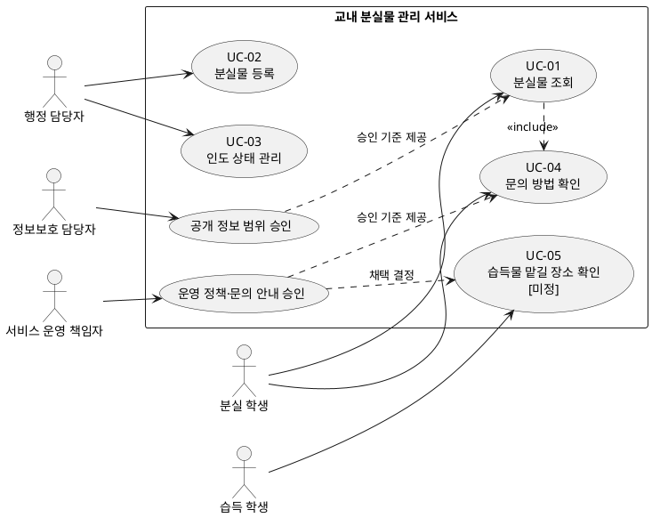

# 소프트웨어 요구사항 명세서 v0.1 — 교내 분실물 관리 서비스

| 항목 | 내용 |
|---|---|
| 문서 상태 | 초안 — 미정 질문의 답변 및 운영 책임자 승인 필요 |
| 입력 근거 | `고객 요구사항.md` (이하 “원문”) |
| 대상 릴리스 | v0.1 |
| 범위 | 가상 데이터를 사용하는 교내 분실물 조회·등록·상태 관리·문의 안내 |

## 1. 목적과 범위

분실 학생이 행정실을 반복 방문하지 않고 **방문 전** 물품의 보관 여부, 보관 위치 및 문의 방법을 확인하게 한다. 행정 담당자는 물품을 등록하고 보관 중/인도 완료 상태를 구분한다. 이 문서는 구현과 시험의 기준이 되는 요구사항 초안이다.

### 1.1 범위 결정

| 구분 | 항목 | 상태 | 원문 근거 | 명세 처리 |
|---|---|---|---|---|
| 포함 | 보관 여부·위치 조회 | 확정 | SC1, NEEDS_1 | UC-01, FR-01~05 |
| 포함 | 분실물 정보 등록 | 확정 | SC2, NEEDS_2 | UC-02, FR-06~09 |
| 포함 | 보관 중/인도 완료 상태 구분 | 확정 | SC3, NEEDS_3 | UC-03, FR-10~13 |
| 포함 | 담당 부서 및 문의 방법 안내 | 확정 | SC6, NEEDS_4 | UC-04, FR-14~15 |
| 미정 | 습득물 맡길 장소 안내 | 질문 | SC4, NEEDS_5 | UC-05 후보; 승인 전 구현·시험 범위 제외 |
| 제외 | 사진 업로드·유사 사진 매칭 | 확정 | SC5 | 구현하지 않음 |
| 제외 | 매칭 결과 자동 알림 | 확정 | SC7 | 구현하지 않음 |
| 제외 | 개인 휴대전화 번호 공개 | 확정 | SC8, NEEDS_6 | 어떤 화면·응답에도 표시하지 않음 |
| 제약 | 실제 개인정보·학교 인증 연동 | 확정 | C_1 | 가상 데이터만 사용; 인증 연동 구현 안 함 |

### 1.2 용어

| 용어 | 정의 |
|---|---|
| 물품 | 분실물로 등록되어 조회·관리 대상이 되는 하나의 기록 |
| 보관 중 | 아직 인도 완료로 처리되지 않아 조회 대상이 되는 상태 |
| 인도 완료 | 담당자가 인도 처리를 완료한 상태 |
| 문의 방법 | 담당 부서명, 연락/방문 채널 및 이용 안내. 개인 휴대전화 번호는 포함하지 않음 |

## 2. 공통 정책·업무 규칙과 미정 질문

상태의 의미는 다음과 같다. **확정**은 원문에서 포함/제외/제약으로 결정된 사항, **질문**은 결정 전이라 구현을 고정할 수 없는 사항, **제안**은 검증 가능하도록 초안이 제시하는 기본안이며 승인 전 변경 가능하다.

| ID | 정책/업무 규칙 | 상태 | 원문 근거 | 검증 기준 또는 후속 조치 |
|---|---|---|---|---|
| BR-01 | 사용자는 보관 여부와 위치를 방문 전에 조회할 수 있다. | 확정 | S1, SC1, NEEDS_1 | 보관 중 물품을 검색하면 보관 위치가 결과에 표시된다. |
| BR-02 | 행정 담당자는 물품 정보를 등록하고 관리한다. | 확정 | S2, SC2, NEEDS_2 | 등록 후 조회 가능한 물품 기록이 생성된다. |
| BR-03 | 물품 상태는 최소 `보관 중`과 `인도 완료`를 구분한다. | 확정 | S2, SC3, NEEDS_3 | 두 상태가 기록·표시되며 상태별로 식별 가능하다. |
| BR-04 | 담당 부서와 문의 방법을 안내한다. | 확정 | SC6, NEEDS_4 | 조회 화면에서 문의 안내를 확인할 수 있다. |
| BR-05 | 개인 휴대전화 번호를 공개하지 않는다. | 확정 | S4, SC8, NEEDS_6 | 화면, API 응답, 샘플 데이터에 개인 번호가 없다. |
| BR-06 | 실제 개인정보와 학교 인증 연동을 사용하지 않는다. | 확정 | C_1 | 테스트 데이터는 가상 데이터이고 외부 인증 호출이 없다. |
| BR-07 | 사진 매칭, 사진 기반 조회 및 자동 알림은 제공하지 않는다. | 확정 | SC5, SC7 | UI/API/배치 기능이 제공되지 않는다. |
| BR-08 | 상태를 인도 완료로 변경할 수 있는 역할과 정정 절차를 정한다. | 질문 | SC3 | 운영 책임자가 권한자·오입력 정정 주체·이력 보존 여부를 결정한다. |
| BR-09 | 조회 검색 조건과 조회 결과 공개 항목을 정한다. | 질문 | SC1, NEEDS_1, NEEDS_6 | 정보보호 담당자가 공개 항목을 승인한다. |
| BR-10 | 등록의 필수 항목과 입력값 기준을 정한다. | 질문 | SC2, NEEDS_2 | 행정 담당자가 최소 등록 정보와 선택 항목을 확정한다. |
| BR-11 | 문의 안내의 구체적 채널·운영시간·담당 부서를 정한다. | 질문 | SC6, NEEDS_4 | 서비스 운영 책임자가 문구와 최신화 책임자를 지정한다. |
| BR-12 | 습득물 맡길 장소 안내를 시스템 기능으로 포함할지 결정한다. | 질문 | S3, SC4, NEEDS_5 | 기존 안내의 존재 및 필요성을 확인해 UC-05 채택 여부를 승인한다. |
| BR-13 | 등록 부담의 기준선, 측정 방법 및 개선 목표를 정한다. | 질문 | S2, NEEDS_7 | 예: 등록 1건 평균 완료 시간과 목표치를 승인한다. |
| BR-14 | 검색어는 물품명 또는 분류와 일치/포함되는 보관 중 물품을 찾도록 한다. | 제안 | SC1의 “검색 조건 미정” | 승인 시 FR-01의 기본 검색 규칙으로 시험한다. |
| BR-15 | 인도 완료 물품은 일반 학생의 기본 조회 결과에서 제외하고, 담당자는 상태별로 확인할 수 있다. | 제안 | SC3의 상태 구분 목적 | 승인 시 FR-03 및 UC-01/03에 적용한다. |
| BR-16 | 최소 등록 항목은 물품명, 분류, 습득일, 보관 위치, 상태로 한다. | 제안 | SC2의 “필수 입력 항목 미정” | 승인 시 FR-06의 필수값 검증에 적용한다. |

## 3. 사용자 목표, 액터 및 유스케이스

### 3.1 사용자 목표

| 액터 | 무엇을 하려는가 | 왜 하려는가 | 근거 |
|---|---|---|---|
| 분실 학생 | 보관 여부·위치와 문의 방법을 조회한다. | 불필요한 행정실 방문과 반복 문의를 줄이기 위해 | S1, NEEDS_1, NEEDS_4 |
| 행정 담당자 | 물품을 등록하고 인도 상태를 관리한다. | 반복 문의를 줄이고 보관 물품과 인도 물품을 구분하기 위해 | S2, NEEDS_2, NEEDS_3 |
| 습득 학생 | 습득물을 맡길 장소를 확인한다. | 습득물을 올바른 장소에 맡기기 위해 | S3, NEEDS_5 |
| 정보보호 담당자 | 공개 정보 범위를 검토·승인한다. | 불필요한 개인정보 공개를 막기 위해 | S4, NEEDS_6 |
| 서비스 운영 책임자 | 정책 및 책임 주체를 결정한다. | 운영의 책임·갱신 기준을 명확히 하기 위해 | 이해관계자 표, BR-08~13 |

### 3.2 액터 목록

| ID | 액터 | 분류 | 시스템과의 관계 |
|---|---|---|---|
| ACT-01 | 분실 학생 | 주 액터 | UC-01, UC-04 수행 |
| ACT-02 | 행정 담당자 | 주 액터 | UC-02, UC-03 수행 |
| ACT-03 | 습득 학생 | 주 액터 | UC-05 후보 수행 |
| ACT-04 | 정보보호 담당자 | 지원/승인 액터 | 공개 범위 정책 승인 |
| ACT-05 | 서비스 운영 책임자 | 지원/승인 액터 | 운영 정책·문의 안내 승인 |

### 3.3 유스케이스 목록

| ID | 유스케이스 | 주 액터 | 상태 | 목표 |
|---|---|---|---|---|
| UC-01 | 분실물 조회 | 분실 학생 | 확정 | 보관 여부와 위치 확인 |
| UC-02 | 분실물 등록 | 행정 담당자 | 확정 | 조회 가능한 물품 기록 생성 |
| UC-03 | 인도 상태 관리 | 행정 담당자 | 확정 | 보관 중/인도 완료 구분 |
| UC-04 | 문의 방법 확인 | 분실 학생 | 확정 | 담당 부서와 문의 채널 확인 |
| UC-05 | 습득물 맡길 장소 확인 | 습득 학생 | 미정 | 습득물 인계 장소 확인 |

### 3.4 유스케이스 다이어그램

| 액터 | 연결 유스케이스 | 연결 성격 |
|---|---|---|
| 분실 학생 | UC-01, UC-04 | 조회 중 안내를 확인 |
| 행정 담당자 | UC-02, UC-03 | 기록 생성 및 상태 관리 |
| 습득 학생 | UC-05 | 범위 확정 시 안내 조회 |
| 정보보호 담당자 | 공개 정보 범위 승인 | UC-01 공개 필드의 승인자 |
| 서비스 운영 책임자 | 운영 정책·문의 안내 승인 | UC-04 내용 및 UC-05 채택 승인자 |

## 4. 유스케이스(UC) 명세

### UC-01 — 분실물 조회

| 항목 | 내용 |
|---|---|
| ID / UC 명 | UC-01 / 분실물 조회 |
| 목표 | 분실 학생이 방문 전에 보관 여부와 보관 위치를 확인한다. |
| 액터 | 주: 분실 학생 |
| 출처 | S1, SC1, NEEDS_1, NEEDS_6 |
| 사전 조건 | 공개 항목 정책(BR-09)이 승인되어 있고, 조회 가능한 보관 중 물품이 등록되어 있다. |
| 트리거 | 분실 학생이 조회 화면에서 검색을 요청한다. |
| 사후 조건 | 결과가 있으면 승인된 정보 범위 안에서 보관 위치와 문의 방법이 표시된다. 결과가 없으면 미보관/미검색 결과가 표시된다. |
| 실패 시 보존 조건 | 검색 실패·입력 오류가 발생해도 기존 물품 기록과 상태는 변경되지 않는다. |
| 기본 흐름 | 1) 학생이 검색어를 입력한다. 2) 시스템이 검색어와 일치하는 보관 중 물품을 찾는다. 3) 시스템이 승인된 항목만으로 결과(물품 식별 정보, 보관 위치, 상태)를 표시한다. 4) 시스템이 UC-04의 문의 방법을 표시한다. |
| 대안 흐름 | A1) 여러 결과가 있으면 시스템은 각 결과를 구분해 목록으로 표시하고 학생은 하나를 선택해 상세를 본다. A2) 검색어가 비어 있으면 시스템은 검색어 입력을 요청한다. |
| 예외 흐름 | E1) 일치 결과가 없으면 시스템은 “일치하는 보관 중 물품 없음”을 표시하고 문의 방법을 유지한다. E2) 승인되지 않은 필드가 결과에 포함되려 하면 시스템은 해당 필드를 표시하지 않고 오류를 기록한다. |

### UC-02 — 분실물 등록

| 항목 | 내용 |
|---|---|
| ID / UC 명 | UC-02 / 분실물 등록 |
| 목표 | 행정 담당자가 조회·관리할 물품 기록을 생성한다. |
| 액터 | 주: 행정 담당자 |
| 출처 | S2, SC2, NEEDS_2, NEEDS_7 |
| 사전 조건 | 행정 담당자가 등록 권한을 보유한다. 필수 입력 정책(BR-10)이 승인되어 있다. |
| 트리거 | 행정 담당자가 새 물품 등록을 요청한다. |
| 사후 조건 | 유효한 입력이면 고유 식별자를 가진 물품 기록이 생성되고 초기 상태가 저장된다. |
| 실패 시 보존 조건 | 유효성 검증 또는 저장 실패 시 물품 기록은 생성·부분 갱신되지 않는다. |
| 기본 흐름 | 1) 담당자가 등록 화면을 연다. 2) 시스템이 필수·선택 항목을 표시한다. 3) 담당자가 정보를 입력하고 저장을 요청한다. 4) 시스템이 필수값과 형식을 검증한다. 5) 시스템이 물품 기록을 생성하고 성공 및 식별자를 표시한다. |
| 대안 흐름 | A1) 선택 항목이 비어 있으면 시스템은 허용된 범위에서 저장한다. A2) 유사한 기존 기록이 있으면 시스템은 경고하고 담당자가 계속 등록 또는 취소를 선택한다. *(중복 판단 기준은 제안)* |
| 예외 흐름 | E1) 필수값 누락/형식 오류면 시스템은 항목별 오류를 표시하고 저장하지 않는다. E2) 저장소 오류면 시스템은 실패를 알리고 재시도를 제공하며 중복 생성하지 않는다. |

### UC-03 — 인도 상태 관리

| 항목 | 내용 |
|---|---|
| ID / UC 명 | UC-03 / 인도 상태 관리 |
| 목표 | 행정 담당자가 보관 중 물품과 인도 완료 물품을 기록·구분한다. |
| 액터 | 주: 행정 담당자 |
| 출처 | S2, SC3, NEEDS_3 |
| 사전 조건 | 대상 물품 기록이 존재한다. 상태 변경 권한·정정 정책(BR-08)이 승인되어 있다. |
| 트리거 | 담당자가 대상 물품의 상태 변경을 요청한다. |
| 사후 조건 | 대상 물품의 상태가 요청한 유효 상태로 저장되고 조회/관리 화면에서 구분된다. |
| 실패 시 보존 조건 | 권한 없음, 잘못된 상태값, 저장 실패 시 기존 상태는 유지된다. |
| 기본 흐름 | 1) 담당자가 물품을 선택한다. 2) 시스템이 현재 상태를 표시한다. 3) 담당자가 상태를 `보관 중` 또는 `인도 완료`로 지정하고 저장한다. 4) 시스템이 권한과 상태값을 검증한다. 5) 시스템이 상태를 저장하고 변경 결과를 표시한다. |
| 대안 흐름 | A1) 현재 상태와 같은 값을 요청하면 시스템은 변경 없음으로 알리고 기록을 중복 변경하지 않는다. A2) 인도 완료 물품을 찾을 필요가 있으면 담당자는 상태 필터로 조회한다. |
| 예외 흐름 | E1) 권한이 없으면 시스템은 변경을 거부한다. E2) 대상 기록이 삭제/동시 변경되어 없거나 갱신되었으면 시스템은 최신 상태를 다시 표시하고 저장하지 않는다. |

### UC-04 — 문의 방법 확인

| 항목 | 내용 |
|---|---|
| ID / UC 명 | UC-04 / 문의 방법 확인 |
| 목표 | 분실 학생이 담당 부서와 안전한 문의 방법을 확인한다. |
| 액터 | 주: 분실 학생; 지원: 서비스 운영 책임자 |
| 출처 | S5, SC6, NEEDS_4, NEEDS_6 |
| 사전 조건 | 문의 안내 내용과 공개 범위(BR-11, BR-09)가 승인되어 있다. |
| 트리거 | 학생이 조회 결과 또는 문의 안내 화면을 연다. |
| 사후 조건 | 담당 부서와 승인된 문의 채널/안내가 표시된다. |
| 실패 시 보존 조건 | 안내 정보를 읽는 동작은 물품 기록·상태를 변경하지 않는다. |
| 기본 흐름 | 1) 학생이 문의 안내를 요청한다. 2) 시스템이 최신 승인 안내를 조회한다. 3) 시스템이 담당 부서와 문의 방법을 표시한다. |
| 대안 흐름 | A1) UC-01 결과 화면에서 시스템이 문의 안내를 함께 표시한다. |
| 예외 흐름 | E1) 승인된 안내가 없거나 만료되었으면 시스템은 개인 연락처를 대체 표시하지 않고 “담당 부서 안내를 확인 중”을 표시하며 운영자에게 갱신 필요를 알린다. |

### UC-05 — 습득물 맡길 장소 확인 (후보)

| 항목 | 내용 |
|---|---|
| ID / UC 명 | UC-05 / 습득물 맡길 장소 확인 |
| 목표 | 습득 학생이 물품을 인계할 장소를 확인한다. |
| 액터 | 주: 습득 학생 |
| 출처 | S3, SC4, NEEDS_5 |
| 상태 | **미정** — 운영 책임자의 범위 승인 전 구현 및 인수시험 대상이 아니다. |
| 사전 조건 | 운영 책임자가 프로그램 내 안내 제공을 승인하고 안내 내용을 확정한다. |
| 트리거 | 습득 학생이 맡길 장소 안내를 요청한다. |
| 사후 조건 | 승인된 인계 장소·운영 안내가 표시된다. |
| 실패 시 보존 조건 | 안내 조회는 물품 기록을 생성·변경하지 않는다. |
| 기본 흐름 | 1) 학생이 안내를 요청한다. 2) 시스템이 승인된 장소와 안내를 표시한다. |
| 대안 흐름 | A1) 기존 학교 안내 링크만 제공하기로 하면 시스템은 해당 링크/안내를 표시한다. |
| 예외 흐름 | E1) 안내가 확정되지 않았으면 시스템은 임의 장소를 표시하지 않고 담당 부서 문의 방법을 표시한다. |

## 5. 기능 요구사항

각 요구사항은 식별 가능한 수용 기준을 가진다. BR-14~16은 제안이므로 해당 질문의 승인 후 확정한다.

### FR-01 — 보관 중 물품 검색

시스템은 분실 학생이 검색어로 보관 중 물품을 조회할 수 있게 해야 한다. 승인 전 기본안은 물품명 또는 분류의 포함 일치 검색이다. (연결: UC-01 기본 흐름 1~2, BR-01, BR-14)

수용 기준: `이어폰` 검색 시 물품명 또는 분류에 `이어폰`을 포함하고 상태가 `보관 중`인 가상 기록만 결과로 반환한다.

### FR-02 — 조회 결과의 안전한 공개

시스템은 승인된 공개 항목만 조회 결과에 표시해야 하며, 개인 휴대전화 번호를 표시·반환·저장해서는 안 된다. (연결: UC-01 기본 흐름 3, 예외 E2, BR-05, BR-09)

수용 기준: 조회 화면과 조회 API가 개인 번호 필드를 포함하지 않고, 승인되지 않은 필드는 표시되지 않는다.

### FR-03 — 상태별 조회 가시성

시스템은 물품 상태를 구분해 표시해야 한다. 승인 전 기본안으로 일반 학생 조회에는 `보관 중`만, 담당자 관리 화면에는 두 상태 모두를 표시한다. (연결: UC-01, UC-03 A2, BR-03, BR-15)

수용 기준: 인도 완료 기록은 일반 학생 기본 검색 결과에 없고, 담당자 상태 필터에서는 `인도 완료`로 조회된다.

### FR-04 — 위치 표시

시스템은 조회 결과가 있는 보관 중 물품에 승인된 보관 위치를 표시해야 한다. (연결: UC-01 기본 흐름 3, BR-01)

수용 기준: 등록된 위치가 `행정실 보관함 A`인 결과를 선택하면 동일 위치가 표시된다.

### FR-05 — 무결과 처리

시스템은 일치 결과가 없을 때 결과 없음 메시지와 문의 방법을 표시해야 한다. (연결: UC-01 E1)

수용 기준: 존재하지 않는 검색어를 입력하면 물품 상세 대신 결과 없음 메시지와 UC-04 안내가 표시된다.

### FR-06 — 물품 등록 및 필수값 검증

시스템은 권한 있는 행정 담당자가 물품을 등록하게 하고, 승인된 필수 항목의 누락 또는 형식 오류를 저장 전에 표시해야 한다. 제안 최소 항목은 물품명, 분류, 습득일, 보관 위치, 상태이다. (연결: UC-02 기본 흐름 1~5, BR-10, BR-16)

수용 기준: 제안 최소 항목 중 하나가 없으면 해당 오류와 함께 저장되지 않으며, 모두 유효하면 고유 식별자가 생성된다.

### FR-07 — 등록 초기 상태

시스템은 새 물품의 상태를 유효한 상태값으로 저장해야 한다. 초기 상태 정책이 확정되기 전 기본값은 `보관 중`으로 제안한다. (연결: UC-02 사후 조건, UC-03, BR-03)

수용 기준: 초기 상태를 지정하지 않고 등록한 유효 기록은, 제안안 승인 시, `보관 중`으로 저장된다.

### FR-08 — 등록 실패의 원자성

시스템은 등록 검증 또는 저장 실패 시 부분 물품 기록을 남기지 않아야 한다. (연결: UC-02 실패 시 보존 조건, 예외 E1~E2)

수용 기준: 저장 오류를 재현한 후 물품 목록에서 새 식별자나 불완전 기록이 발견되지 않는다.

### FR-09 — 등록 결과 확인

시스템은 등록 성공 시 생성된 물품의 식별자와 성공 상태를 담당자에게 표시해야 한다. (연결: UC-02 기본 흐름 5)

수용 기준: 유효한 등록을 저장하면 성공 메시지와 생성 식별자가 한 번 표시된다.

### FR-10 — 상태 변경

시스템은 권한 있는 행정 담당자가 기존 물품 상태를 `보관 중` 또는 `인도 완료`로 변경하도록 해야 한다. (연결: UC-03 기본 흐름 1~5, BR-03, BR-08)

수용 기준: 권한 있는 담당자가 보관 중 기록을 인도 완료로 저장하면 재조회 시 상태가 인도 완료로 표시된다.

### FR-11 — 상태 변경 검증과 보존

시스템은 권한 없는 변경, 정의되지 않은 상태값, 저장 실패를 거부하고 기존 상태를 보존해야 한다. (연결: UC-03 실패 시 보존 조건, E1~E2)

수용 기준: 권한 없는 사용자가 상태 변경을 요청하면 거부되며 대상 기록의 상태값은 요청 전과 같다.

### FR-12 — 상태별 관리 조회

시스템은 행정 담당자가 보관 중 및 인도 완료 물품을 구분하여 확인하도록 상태 표시 또는 필터를 제공해야 한다. (연결: UC-03 A2)

수용 기준: 담당자가 `인도 완료` 필터를 선택하면 인도 완료 상태의 기록만 표시된다.

### FR-13 — 동일 상태 요청 처리

시스템은 현재 상태와 같은 상태 변경 요청을 중복 변경으로 저장하지 않고 변경 없음으로 알려야 한다. (연결: UC-03 A1)

수용 기준: 보관 중 기록에 보관 중을 요청하면 상태 갱신 시각/이력(존재 시)이 새로 생성되지 않고 변경 없음 메시지가 표시된다.

### FR-14 — 문의 안내 표시

시스템은 조회 결과 및 별도 안내 화면에서 승인된 담당 부서와 문의 방법을 표시해야 한다. (연결: UC-04 기본 흐름, UC-01 기본 흐름 4, BR-04, BR-11)

수용 기준: 조회 결과 화면과 문의 안내 화면에서 동일한 최신 승인 안내가 표시된다.

### FR-15 — 안내 정보 부재 처리

시스템은 승인된 문의 안내가 없거나 만료되었을 때 개인 연락처를 대신 표시하지 않고 안내 갱신 필요 상태를 표시해야 한다. (연결: UC-04 E1)

수용 기준: 안내 데이터를 비활성화하면 화면에 개인 번호 없이 갱신 필요 메시지가 표시된다.

## 6. 비기능 요구사항

### 6.1 품질 요구사항

| ID | 요구사항 | 상태 | 검증 방법 |
|---|---|---|---|
| NFR-01 | 일반적인 교내 네트워크 환경에서 검색 결과 또는 오류 안내를 요청 후 3초 이내에 표시해야 한다. | 제안 | 대표 가상 데이터로 30회 측정해 95% 이상 3초 이내인지 확인 |
| NFR-02 | 등록·상태 변경 요청의 성공/실패 결과를 3초 이내에 명확히 표시해야 한다. | 제안 | 성공·유효성 오류·저장 오류 시나리오별 응답 시간과 메시지 확인 |
| NFR-03 | 조회·등록·상태 변경 화면은 키보드만으로 주요 입력·실행·결과 확인이 가능해야 한다. | 제안 | 키보드 탭/Enter로 UC-01~03의 기본 흐름 수행 |
| NFR-04 | 오류 메시지는 실패 원인(누락 항목, 권한 없음, 결과 없음 등)과 사용자의 다음 조치를 한국어로 알려야 한다. | 제안 | UC 예외 흐름별 메시지 검토 및 사용자 시험 |
| NFR-05 | 시스템은 조회 결과와 문의 안내에서 개인 휴대전화 번호를 노출하지 않아야 한다. | 확정 | UI, API, 로그 샘플 및 가상 데이터 검토 |
| NFR-06 | 가상 데이터만 사용하고 실제 개인정보 및 학교 인증 시스템과 통신하지 않아야 한다. | 확정 | 테스트 데이터 점검, 네트워크/연동 구성 점검 |

### 6.2 제약 조건

| ID | 제약 | 상태 | 검증 방법 |
|---|---|---|---|
| CON-01 | 사진 업로드·유사 사진 검색·사진 자동 매칭을 구현하지 않는다. | 확정 | UI/API/저장소 스키마와 릴리스 범위 검토 |
| CON-02 | 자동 알림 발송 기능을 구현하지 않는다. | 확정 | 알림 채널, 수신자 정보, 발송 작업이 없는지 점검 |
| CON-03 | 개인 휴대전화 번호 공개 기능을 구현하지 않는다. | 확정 | FR-02, NFR-05 시험 |
| CON-04 | 학교 인증 연동을 구현하지 않는다. 역할 판별 방식은 운영 정책 확정이 필요하다. | 확정 + 질문 | 외부 인증 호출 없음 확인; 권한 대체 방안 승인 |
| CON-05 | 습득물 장소 안내(UC-05)는 범위 승인 전 릴리스 완료 기준에서 제외한다. | 확정 | 승인 기록 또는 범위 변경 전에는 UC-05 시험을 강제하지 않음 |

## 7. 요구사항 추적표

요구사항 ID 링크는 본 문서의 상세 요구사항으로 이동한다. `—`는 아직 기능 요구사항으로 확정하지 않은 정책/질문이다.

| 고객 요구/근거 | 정책·유스케이스 | 구현 요구사항 | 검증 산출물 |
|---|---|---|---|
| NEEDS_1 / S1·SC1 | BR-01, BR-09, BR-14; UC-01 | [FR-01](#fr-01), [FR-02](#fr-02), [FR-03](#fr-03), [FR-04](#fr-04), [FR-05](#fr-05) | UC-01 기본·A1·A2·E1·E2 시험 |
| NEEDS_2 / S2·SC2 | BR-02, BR-10, BR-16; UC-02 | [FR-06](#fr-06), [FR-07](#fr-07), [FR-08](#fr-08), [FR-09](#fr-09) | UC-02 기본·A1·A2·E1·E2 시험 |
| NEEDS_3 / S2·SC3 | BR-03, BR-08, BR-15; UC-03 | [FR-03](#fr-03), [FR-10](#fr-10), [FR-11](#fr-11), [FR-12](#fr-12), [FR-13](#fr-13) | UC-03 기본·A1·A2·E1·E2 시험 |
| NEEDS_4 / S5·SC6 | BR-04, BR-11; UC-04 | [FR-14](#fr-14), [FR-15](#fr-15) | UC-04 기본·A1·E1 시험 |
| NEEDS_5 / S3·SC4 | BR-12; UC-05 후보 | — | 범위 승인 결정; 채택 시 별도 FR·시험 추가 |
| NEEDS_6 / S4·SC8·C_1 | BR-05, BR-06, BR-09; UC-01·UC-04 | [FR-02](#fr-02), [FR-14](#fr-14), [FR-15](#fr-15), NFR-05, NFR-06 | 개인정보 노출·가상 데이터·연동 부재 점검 |
| NEEDS_7 / S2 | BR-13; UC-02 | [FR-06](#fr-06)~[FR-09](#fr-09) (기능 기반) | 기준선·목표 승인 후 사용성/업무시간 측정 시험 추가 |
| SC5·SC7·SC8·C_1 | BR-05~07 | CON-01~04 | 범위 제외·제약 점검 |

## 8. 릴리스 전 결정 필요 사항

다음 항목은 개발 착수 또는 인수 기준을 확정하기 전에 담당자가 답해야 한다.

1. **운영 책임자와 권한**: 누가 행정 담당자 권한을 부여하며, 누가 인도 완료를 처리·정정하는가? 정정 이력을 보존해야 하는가?
2. **공개 정보**: 조회 결과에서 물품명·분류·색상·습득일·보관 위치 중 무엇을 공개하는가? 검색 조건은 무엇인가?
3. **등록 양식**: 필수/선택 항목, 날짜 형식, 분류 체계, 중복 경고 기준은 무엇인가?
4. **문의 안내**: 담당 부서, 채널, 운영시간, 안내 갱신 주체와 만료 기준은 무엇인가?
5. **습득물 안내**: 기존 학교 안내가 있는가? 없다면 UC-05를 이번 릴리스에 포함하는가?
6. **등록 부담 목표**: 현재 등록 1건 평균 소요 시간, 측정 표본·방법, 목표 시간 또는 감소율은 얼마인가?
7. **권한 대체 방식**: 학교 인증 연동 없이 가상 환경에서 행정 담당자를 어떻게 구분할 것인가?

